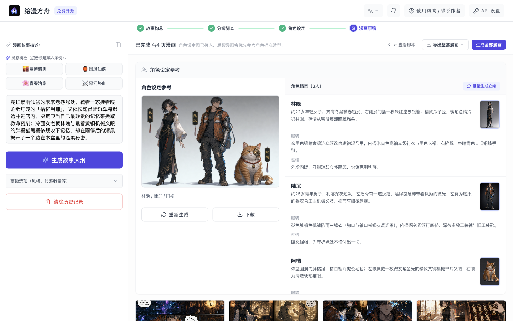
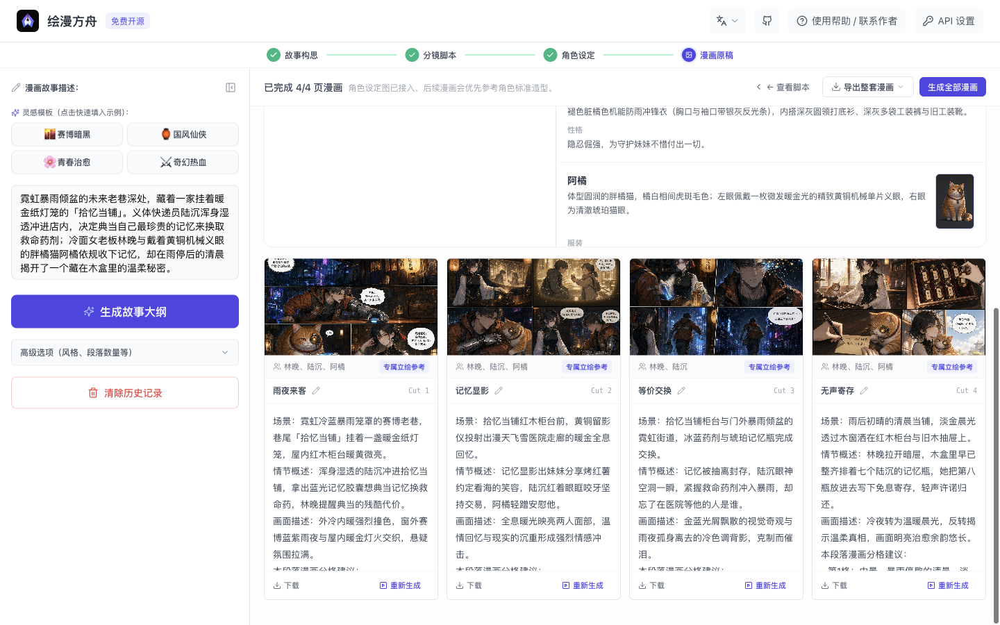

# Huiman Ark

<p align="center">
  
</p>
<p align="center">
  <a href="https://github.com/GL-Wen/huiman-ark"></a>
  <a href="./LICENSE"></a>
  <a href="https://nextjs.org/"></a>
  <a href="https://www.typescriptlang.org/"></a>
  <a href="https://huiman.antmoo.com"></a>
  <a href="https://x.com/antmoch"></a>
</p>

[中文](./README.md) | English

> ⭐️ **If this open-source project helps your AI comic workflow or Next.js development, please give it a Star ⭐️!**

Turn stories into storyboard scripts, character designs, standalone character portraits, and multi-panel comic pages. Built with Next.js, React, TypeScript, and Tailwind CSS, with Chinese, English, and Japanese interfaces.

Huiman Ark uses the [MIT license](./LICENSE): free to use, modify, distribute, and use commercially. No registration, login, or recharge is required. Use the deployment's default API configuration or supply your own in the interface. API usage is billed to the provider account associated with the Key used.

## Online access and support

If you cannot deploy the app, use the [online demo](https://huiman.antmoo.com). It runs this repository's free version, with no registration, login, or recharge. Contact the author for usage or deployment help.

Public support contacts: WeChat **13623839679** · Email [toowell2015@126.com](mailto:toowell2015@126.com) · QQ **3575554244** · X (Twitter) [@antmoch](https://x.com/antmoch). The project owner has authorized publishing these support contacts.

**Collaboration and custom tools**: If you have a repetitive creative or business workflow you'd like turned into a tool, contact the author; a working demo can be built for free first.

On the online demo or any deployed instance, no self-hosting or Huiman Ark account is required:

1. Open “API settings” in Huiman Ark. Leave the request URL, text model, image model, and API Key empty to inherit the deployment's defaults.
2. If you need your own Key, use one from the configured provider. For the default AntMoo provider, [register](https://api.antmoo.cc/register), sign in, and create a Key on the [API tokens page](https://api.antmoo.cc/console/token).
3. Enter a story to generate its outline, characters, and comic pages. Open “Help / Contact author” for instructions and support contacts.

The software is free; model calls may incur charges from the API provider. Check the provider's terms and pricing.

## Features

The workflow features a guided four-stage process: **1. Inspiration & Style Settings → 2. Story & Storyboard Outline → 3. Character Sheets & Individual Portraits → 4. Comic Generation & Rich Export**. You can also skip character design and generate pages directly from the script.

- **Visual stepper navigation**: A clear top progress bar with stage indicators, status tracking, and one-click navigation across completed steps for an intuitive, structured workflow.
- **Story inspiration templates**: Built-in curated presets (Cyberpunk Noir, Xianxia Fantasy, Slice-of-Life Healing, Shonen Adventure, etc.) displayed in a responsive 2-column grid. Populate story concepts, art style preferences, and storyboard parameters with a single click.
- **Story outline & inline storyboard editing**: Turn a story description into a multi-segment storyboard script (automatic 8–15 segments, fixed 5/8/10/12/15 segments, or custom 1–100; panels configurable from 3~6). Each storyboard card supports **direct inline editing** of scene prompts and descriptions with instant saves; the sidebar can be **collapsed or expanded** to maximize the workspace.
- **Character profiles & standalone portraits**: Automatically extracts structured character profiles (name, appearance, outfit, personality, role, camera staging) from the script. Supports generating the full ensemble character design sheet as well as **generating single or batch individual character portraits**, complete with thumbnail previews and lightbox viewing.
- **Decoupled style & dynamic per-cut character reference**: Decouples user style reference images from character design sheets. When generating comic pages, the system automatically detects which characters appear in the segment and **dynamically injects their individual portraits** as strict visual reference constraints, complete with an indicator badge ("Dedicated Portrait Reference / Ensemble Sheet / Style Reference") to ensure character consistency across panels.
- **Batch generation controls & smart retry**: Generate segment by segment or all at once, with support for 16:9 landscape and 9:16 portrait ratios. Pause or cancel batch generation anytime. Failed segments are automatically tracked with one-click options to "Retry Failed" or "Continue Unfinished".
- **Art styles**: 17 built-in anime styles (kawaii, shonen, cyberpunk, monochrome manga, webtoon, Chinese guofeng, etc.), or describe your own custom styles and artistic preferences.
- **Reference images**: Upload up to 3 reference images (PNG, JPG/JPEG, WEBP, HEIC, HEIF) to guide art style, stroke texture, color palette, and lighting atmosphere.
- **Rich export & stitching**:
  - **Zero-dependency ZIP export**: Powered by a lightweight pure TypeScript PKZip implementation without external third-party libraries; export story outlines, character design sheets, individual portraits, high-res comic cuts, and segment data in a single clean ZIP archive;
  - **Webtoon longstrip stitching**: Automatically stitch all comic panel pages into a seamless vertical longstrip image optimized for mobile scrolling;
  - **Full-size lightbox preview**: Browse full-size images with arrow keys and zoom, or download individual images.
- **Multi-provider text models**: Besides the default / custom OpenAI-compatible endpoint, presets cover Volcengine Ark (standard API, Agent Plan, Coding Plan), Alibaba Bailian (standard API, Coding Plan), and the official Claude API, each with its own URL, model, and Key.
- **Image models**: OpenAI-compatible image endpoints, plus native support for Volcengine Seedream 5.0 Pro / Flash and Bailian Qwen Image 2.1 / 3.0.
- **API configuration**: Override the request URL, text model, image model, and API Key individually in the interface; empty fields inherit deployment defaults.
- **Local persistence**: The creative session is saved in the browser's IndexedDB and restored after a refresh, with no database or cloud account. User-entered API Keys stay in page memory only and must be re-entered after refreshing.
- **Interface languages**: Chinese, English, and Japanese.

## Screenshots




Screenshots illustrate the creative workspace; controls may differ in the current version.

## Run locally

Requirements: **Node.js 22.18 or later** and **pnpm 10.34.5**. Provide an API Key through the server environment or the interface.

```bash
git clone https://github.com/GL-Wen/huiman-ark.git
cd huiman-ark
cp .env.example .env.local
pnpm install --frozen-lockfile
pnpm dev
```

Open [http://localhost:3000](http://localhost:3000), adjust API settings as needed, and start with a story.

Built-in defaults are `https://api.antmoo.cc`, `claude-opus-5-5` for text, and `gpt-image-2` for images. Deployment operators can override them and optionally provide a server-side default Key in `.env.local`:

```dotenv
AI_API_BASE_URL=https://api.antmoo.cc
AI_TEXT_MODEL=claude-opus-5-5
AI_IMAGE_MODEL=gpt-image-2
AI_API_KEY=
```

Each setting resolves in this order: non-empty user value, non-empty environment value, then built-in default. The Key has no built-in value. When a deployment provides a default Key, visitors who leave it empty use the deployment operator's API allowance. Switching to another origin requires the user's own Key; the default Key is never forwarded to another origin.

The Text provider selector offers Volcengine Ark, Alibaba Cloud Model Studio, and the official Claude API, with separate profiles for standard APIs and Plans. Each profile keeps its own address, model, and in-memory key. Named providers require their own key and never inherit the deployment key. Reloading clears every entered key while retaining address and model preferences. Claude uses its official OpenAI-compatible endpoint and supports an optional Workspace ID.

Image generation continues to use the address, key, and image model under Default / Custom. Switching text providers does not overwrite image API settings.

Use the service root URL or an API base URL ending in a version such as `/v1` or `/v3` (for example, Volcengine Ark's `/api/v3`); the version is not added twice. User overrides to a different URL must use public HTTPS. Compatible providers must offer the configured models, support `chat/completions`, `images/generations`, and `images/edits`, and return Base64 images through `b64_json`. Volcengine Seedream 5.0 Pro / Flash uses JSON for both generation and reference edits and returns Base64 PNG data. Alibaba Cloud Qwen Image 2.1 / 3.0 has a dedicated adapter: references are sent as JSON, and validated official OSS results are downloaded and converted to Base64. Other providers that only return remote image URLs remain unsupported.

See the [deployment guide](./docs/deployment.md) for production commands and configuration.

## Data and API Keys

Creative sessions, request URL preferences, and model preferences stay in the current browser. Clearing site data or switching browsers removes access to them; download work you want to keep. User-entered Keys are not stored in IndexedDB or localStorage. The environment Key stays on the server. The public `/api/ai/config` endpoint returns only the default URL, models, and `hasApiKey`, never the Key itself. Generation requests pass through this application's server to the configured AI provider.

Enter a Key only on your own deployment or a trusted HTTPS site. Deployment operators can access forwarded requests and should avoid logging headers, bodies, or Keys.

## Development and contributions

```bash
pnpm lint
pnpm typecheck
pnpm test
pnpm build
```

Issues and pull requests are welcome; see [CONTRIBUTING.md](./CONTRIBUTING.md). Report vulnerabilities privately as described in [SECURITY.md](./SECURITY.md).

Third-party dependencies retain their own licenses. Respect the rights associated with uploaded and generated content, along with your API provider's terms.
