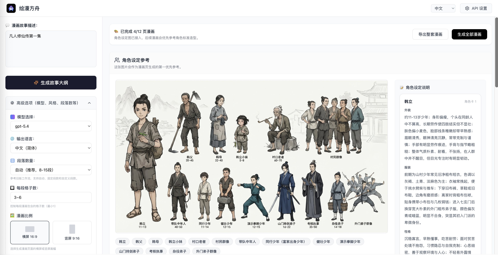
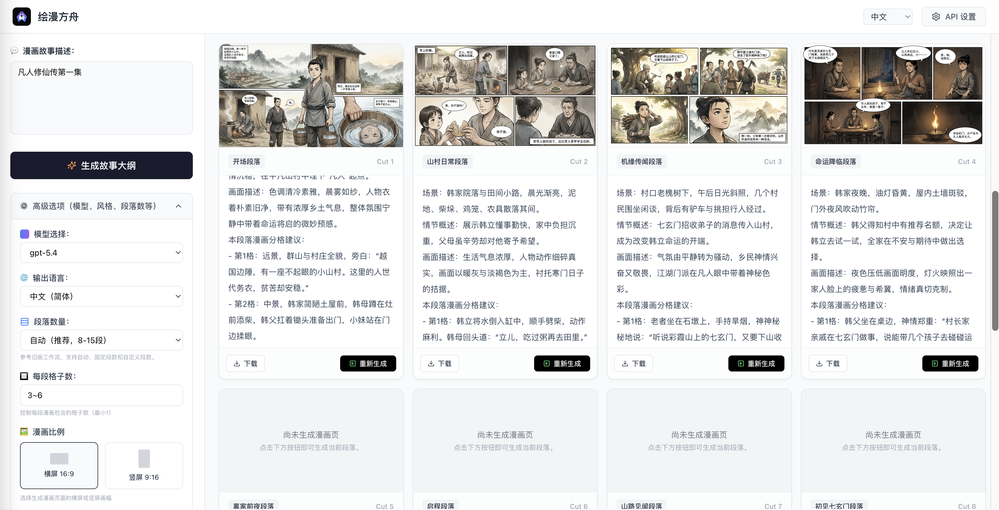

# Huiman Ark

<p align="center">
  
</p>
<p align="center">
  <a href="https://github.com/GL-Wen/huiman-ark"></a>
  <a href="./LICENSE"></a>
  <a href="https://nextjs.org/"></a>
  <a href="https://www.typescriptlang.org/"></a>
  <a href="https://huiman.antmoo.com"></a>
  <a href="https://x.com/antmoch"></a>
</p>

[中文](./README.md) | English

> ⭐️ **If this open-source project helps your AI comic workflow or Next.js development, please give it a Star ⭐️!**

Turn stories into storyboard scripts, character designs, and comic pages. Built with Next.js, React, TypeScript, and Tailwind CSS, with Chinese, English, and Japanese interfaces.

Huiman Ark uses the [MIT license](./LICENSE): free to use, modify, distribute, and use commercially. No registration, login, or recharge is required. Use the deployment's default API configuration or supply your own in the interface. API usage is billed to the provider account associated with the Key used.

## Online access and support

If you cannot deploy the app, visit the [online demo](https://huiman.antmoo.com). **The demo currently runs the older credits-based version; this repository's free version has not been deployed there yet.** Contact the author for help accessing the new version or deploying it.

Public support contacts: WeChat **13623839679** · Email [toowell2015@126.com](mailto:toowell2015@126.com) · QQ **3575554244** · X (Twitter) [@antmoch](https://x.com/antmoch). The project owner has authorized publishing these support contacts.

On an instance running the new version, no self-hosting or Huiman Ark account is required:

1. Open “API settings” in Huiman Ark. Leave the request URL, text model, image model, and API Key empty to inherit the deployment's defaults.
2. If you need your own Key, use one from the configured provider. For the default AntMoo provider, [register](https://api.antmoo.cc/register), sign in, and create a Key on the [API tokens page](https://api.antmoo.cc/console/token).
3. Enter a story to generate its outline, characters, and comic pages. Open “Help / Contact author” for instructions and support contacts.

The software is free; model calls may incur charges from the API provider. Check the provider's terms and pricing.

## Features

- Generate storyboard scripts, character sheets, and comic pages from a story.
- Customize the API provider, text and image models, characters, art style, aspect ratio, paragraphs, and panels.
- Supply reference images for character and style consistency.
- Save the current creative session in your browser's IndexedDB; no database or cloud account is needed.
- Save request URL and model preferences locally; user-entered API Keys stay in page memory only and must be entered again after refreshing.

## Screenshots




Screenshots illustrate the creative workspace; controls may differ in the current version.

## Run locally

Requirements: **Node.js 22.18 or later** and **pnpm 10.34.5**. Provide an API Key through the server environment or the interface.

```bash
git clone https://github.com/GL-Wen/huiman-ark.git
cd huiman-ark
cp .env.example .env.local
pnpm install --frozen-lockfile
pnpm dev
```

Open [http://localhost:3000](http://localhost:3000), adjust API settings as needed, and start with a story.

Built-in defaults are `https://api.antmoo.cc`, `claude-opus-5-5` for text, and `gpt-image-2` for images. Deployment operators can override them and optionally provide a server-side default Key in `.env.local`:

```dotenv
AI_API_BASE_URL=https://api.antmoo.cc
AI_TEXT_MODEL=claude-opus-5-5
AI_IMAGE_MODEL=gpt-image-2
AI_API_KEY=
```

Each setting resolves in this order: non-empty user value, non-empty environment value, then built-in default. The Key has no built-in value. When a deployment provides a default Key, visitors who leave it empty use the deployment operator's API allowance. Switching to another origin requires the user's own Key; the default Key is never forwarded to another origin.

Use the service root URL without `/v1`; user overrides to a different URL must use public HTTPS. Compatible providers must offer the configured models, support `chat/completions`, `images/generations`, and `images/edits`, and return Base64 images through `b64_json`. Providers that only return remote image URLs are not supported.

See the [deployment guide](./docs/deployment.md) for production commands and configuration.

## Data and API Keys

Creative sessions, request URL preferences, and model preferences stay in the current browser. Clearing site data or switching browsers removes access to them; download work you want to keep. User-entered Keys are not stored in IndexedDB or localStorage. The environment Key stays on the server. The public `/api/ai/config` endpoint returns only the default URL, models, and `hasApiKey`, never the Key itself. Generation requests pass through this application's server to the configured AI provider.

Enter a Key only on your own deployment or a trusted HTTPS site. Deployment operators can access forwarded requests and should avoid logging headers, bodies, or Keys.

## Development and contributions

```bash
pnpm lint
pnpm typecheck
pnpm test
pnpm build
```

Issues and pull requests are welcome; see [CONTRIBUTING.md](./CONTRIBUTING.md). Report vulnerabilities privately as described in [SECURITY.md](./SECURITY.md).

Third-party dependencies retain their own licenses. Respect the rights associated with uploaded and generated content, along with your API provider's terms.
