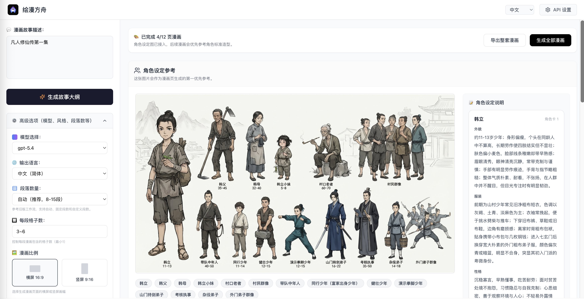
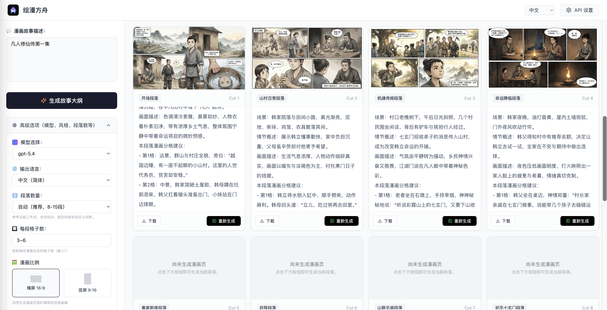

# Huiman Ark（绘漫方舟）

<p align="center">
  
</p>

中文 | [English](./README.en.md)

将故事变成分镜脚本、角色设定和漫画画面的 AI 创作工具。使用 Next.js、React、TypeScript 和 Tailwind CSS 构建，支持中文、英文和日文界面。

项目采用 [MIT 许可证](./LICENSE)，可免费使用、修改、分发和商业使用。无需注册、登录或充值；生成时使用你自己的 API Key，接口费用由 API 服务商收取。

## 功能

- 从故事生成分镜脚本、角色设定图和漫画页。
- 自定义角色、画风、画面比例、段落数和每页格数。
- 使用参考图片保持角色和画面风格。
- 在当前浏览器的 IndexedDB 中保存创作会话，无需数据库或云账户。
- API Key 仅保存在页面内存中，刷新后需要重新填写。

## 界面预览




截图用于展示创作界面，具体控件以当前版本为准。

## 本地运行

需要 Node.js **22.18 或以上**、**pnpm 10.34.5**，以及部署所配置接口的 API Key。

```bash
git clone https://github.com/GL-Wen/huiman-ark.git
cd huiman-ark
cp .env.example .env.local
pnpm install --frozen-lockfile
pnpm dev
```

打开 [http://localhost:3000](http://localhost:3000)，在界面的 API 设置中填写自己的 API Key，然后输入故事开始创作。

默认接口为 `https://api.antmoo.cc`，文本固定使用 `claude-opus-5-5`，图像固定使用 `gpt-image-2`。填写的 Key 必须属于部署者配置的接口，API 用量费用由你的接口账户承担。自行部署时可在 `.env.local` 中更换兼容接口：

```dotenv
AI_API_BASE_URL=https://api.antmoo.cc
```

地址填写服务根地址，不添加 `/v1`。兼容服务需提供上述两个固定模型，支持文本 `chat/completions`、图像 `images/generations` 和 `images/edits` 接口，并返回 Base64 图像（`b64_json`）；仅返回远程图片 URL 的服务不受支持。

生产运行与完整配置见 [部署指南](./docs/deployment.md)。

## 数据与 API Key

创作会话保存在当前浏览器，清除网站数据或更换浏览器后无法恢复，请及时下载需要保留的作品。API Key 不写入 IndexedDB 或 localStorage；每次生成请求会经过本应用服务器转发给配置的 AI 服务。

仅在自己部署或信任的 HTTPS 站点中输入 Key。部署者能够接触转发请求，应避免记录请求头、请求体及 Key。

## 开发与贡献

```bash
pnpm lint
pnpm typecheck
pnpm test
pnpm build
```

欢迎提交 Issue 和 Pull Request，步骤见 [贡献指南](./CONTRIBUTING.md)。安全问题请按 [安全报告说明](./SECURITY.md) 私下反馈。

第三方依赖遵循各自许可证。上传素材和生成内容的使用应尊重相关权利，并遵守所使用 API 服务商的条款。
