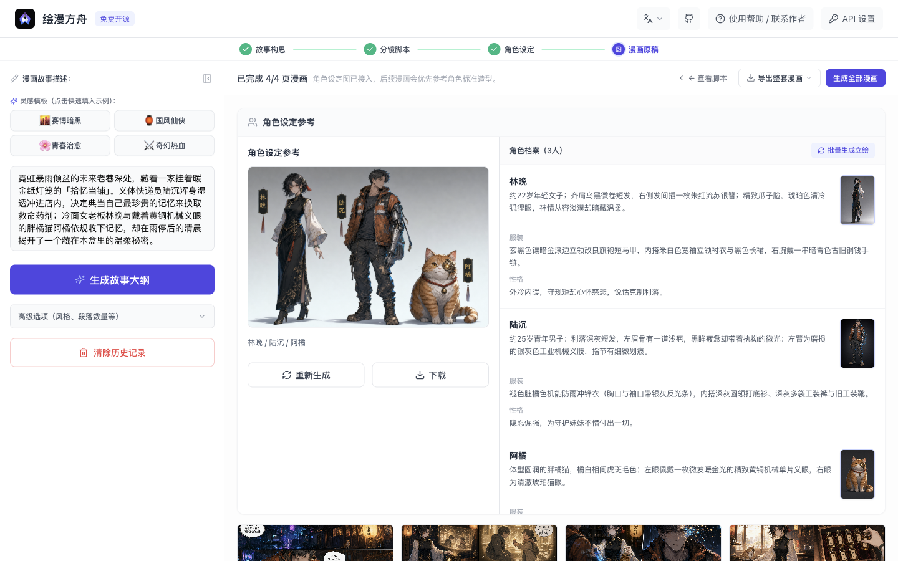
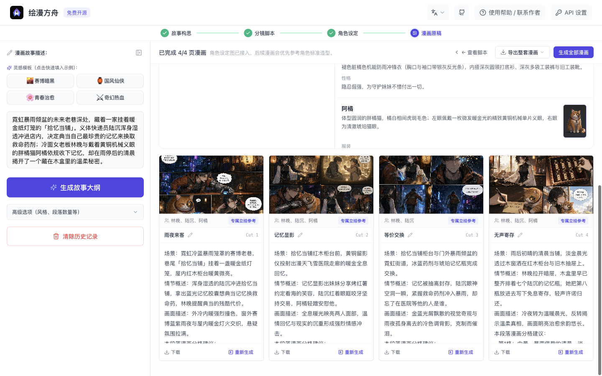

# Huiman Ark（绘漫方舟）

<p align="center">
  
</p>
<p align="center">
  <strong>把小说与故事灵感，变成角色不串脸的多格漫画与竖版长条漫</strong>
</p>
<p align="center">
  <a href="https://github.com/GL-Wen/huiman-ark"></a>
  <a href="./LICENSE"></a>
  <a href="https://nextjs.org/"></a>
  <a href="https://www.typescriptlang.org/"></a>
  <a href="https://huiman.antmoo.com"></a>
  <a href="https://vercel.com/new/clone?repository-url=https%3A%2F%2Fgithub.com%2FGL-Wen%2Fhuiman-ark"></a>
</p>

<p align="center">
  中文 | <a href="./README.en.md">English</a> · <a href="https://huiman.antmoo.com">在线工作台（支持免 Key 预览成品示例）</a> · <a href="./docs/deployment.md">部署指南</a>
</p>

---

## 成片效果展示（角色设定 → 多页连续分镜）

无需训练 LoRA：先从故事大纲提取结构化角色档案、生成角色设定总图与单人立绘，再按每页登场角色**动态注入专属立绘参考**，在多页多格分镜中保持五官、发型与服饰高度一致。

<p align="center">
  
</p>
<p align="center">
  <sub>▲ 自动提取故事角色档案并生成统一画风的角色设定参考图（内置原创示例《雨夜记忆当铺》）</sub>
</p>

<p align="center">
  
</p>
<p align="center">
  <sub>▲ 按分镜登场人物自动挂载 3 张独立立绘参考，连续输出 4 页赛博新国风多格漫画（支持一键拼接为竖版 Webtoon 长条漫或打包 ZIP）</sub>
</p>

> 💡 **零成本先看效果**：打开 [在线工作台](https://huiman.antmoo.com) 或本地启动后，无需配置任何 API Key，直接点击首页 **「免 Key 浏览成品示例」** 即可交互体验全套分镜编辑、角色立绘预览、条漫长图拼接与 ZIP 打包下载。

---

## 为什么选择绘漫方舟？

- **纯本地、无账号、自备 Key（BYOK）**：无需数据库、注册登录或充值体系。创作会话保存在浏览器 IndexedDB 中，API Key 可选保存在本机 `localStorage`（刷新不丢失）或仅留驻页面内存。
- **动态角色立绘注入（防串脸 / 防换装）**：将用户画风参考图与角色设定解耦；生成每一页分镜时自动识别当前段出镜角色，仅注入对应角色的单人立绘作为硬约束参考（自动适配不同模型的参考图数量上限）。
- **四步可控工作流**：`1. 灵感模板与画风设定 → 2. 分镜脚本与行内微调 → 3. 角色设定图与单人立绘 → 4. 批量出图、断点续跑与多元导出`，每一步均可随时回改重跑。
- **主流国内外模型开箱即用**：
  - **文本平台预设**：火山方舟（豆包普通 API / Agent Plan / Coding Plan）、阿里百炼（通义千问普通 API / Coding Plan）、Claude 官方 API 及任意 OpenAI 兼容接口。
  - **图像平台预设**：原生适配 **火山方舟 Seedream 5.0 Flash / Pro**（2K PNG 直出）、**阿里百炼千问图像 2.1 / 3.0** 及 OpenAI 兼容 `images/generations` & `images/edits` 接口；同厂商文本与图像可自动复用同一把普通 API Key。
- **零依赖多元导出**：内置纯 TypeScript PKZip 打包器（一键导出故事大纲 Markdown、分镜 JSON、角色总图、单人立绘与全部漫画切页）及 Canvas **Webtoon 竖版长条漫无缝拼图**。
- **服务端转发安全防护**：内置私网/保留 IP 拦截、DNS 解析绑定（防 DNS Rebinding）、重定向拦截、流式体积硬限与上游报错 Key 自动脱敏。
- **多语言界面与创作**：支持简体中文、English、日本語界面及对应漫画对白语言输出。

---

## 快速开始

### 方式一：一键部署到 Vercel

点击上方 **Deploy with Vercel** 按钮即可零配置部署个人工作台，部署完成后打开页面右上角 **「API 设置」** 填入你自己的模型 Key 即可使用。

### 方式二：本地运行

环境要求：**Node.js >= 22.18.0**、**pnpm 10.34.5**。

```bash
git clone https://github.com/GL-Wen/huiman-ark.git
cd huiman-ark
cp .env.example .env.local
pnpm install --frozen-lockfile
pnpm dev
```

打开 [http://localhost:3000](http://localhost:3000)：

1. 先点 **「免 Key 浏览成品示例」** 熟悉完整分镜、立绘与导出链路；
2. 点击右上角 **「API 设置」**，在下拉框选择 **火山方舟** 或 **阿里百炼**（新开通用户可在 [火山方舟控制台](https://console.volcengine.com/ark/region:ark+cn-beijing/apiKey) 或 [阿里百炼控制台](https://bailian.console.aliyun.com/?apiKey=1#/api-key) 获取 API Key 与官方新客体验额度）；
3. 勾选「记住 API Key」，输入故事或点击左侧灵感模板即可开始生成。

---

## 环境变量（可选）

自托管私有实例时，也可在 `.env.local` 配置服务端默认值（界面留空时继承；公网部署建议保持 `AI_API_KEY` 为空，采用纯 BYOK 模式）：

```dotenv
AI_API_BASE_URL=https://api.antmoo.cc
AI_TEXT_MODEL=claude-opus-5-5
AI_IMAGE_MODEL=gpt-image-2
AI_API_KEY=
NEXT_PUBLIC_SITE_URL=http://localhost:3000
```

详细的多平台套餐入口说明、安全策略与反向代理超时配置请参阅 [部署指南](./docs/deployment.md)。

---

## 工作台界面一览




---

## 开发与校验

```bash
pnpm lint
pnpm typecheck
pnpm test
pnpm build
```

欢迎提交 Issue 与 Pull Request，流程见 [贡献指南](./CONTRIBUTING.md)；安全问题请按 [安全策略](./SECURITY.md) 私下反馈。

---

## 支持与合作

如果这个项目对你的 AI 漫画工作流或全栈开发有帮助，欢迎点亮右上角 **Star ⭐️** 支持！

- **使用交流 / 部署答疑 / 定制工具合作**：微信 `13623839679` · QQ `3575554244` · 邮箱 [toowell2015@126.com](mailto:toowell2015@126.com) · X [@antmoch](https://x.com/antmoch)
- **开源协议**：[MIT License](./LICENSE)
